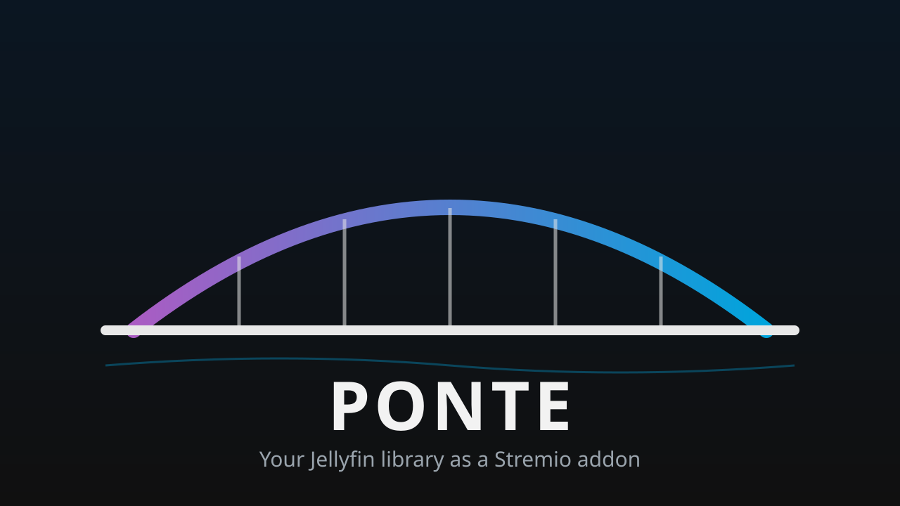

<p align="center"></p>

**Ponte** (Portuguese and Italian for *bridge*) is a Jellyfin plugin that serves your library as a
[Stremio addon](https://github.com/Stremio/stremio-addon-sdk/tree/master/docs). Anything that speaks
the addon protocol can then browse and play your Jellyfin files: Stremio, Nuvio, AIOStreams, Omni
and others.

It is the reverse of [Gelato](https://github.com/lostb1t/Gelato), which brings Stremio addons into
Jellyfin. The two work together: Ponte never serves the items Gelato creates.

## Quick start

1. **Add the repository** in Jellyfin (Dashboard → Plugins → Repositories):
   `https://raw.githubusercontent.com/franzopl/jellyfin-plugin-ponte/main/manifest.json`
2. **Install Ponte** from the catalog and restart Jellyfin.
3. **Copy your addon link** from Dashboard → Plugins → Ponte (other users: `https://<your-jellyfin>/ponte/link`).
4. **Add it to your client**: paste it into Stremio, Nuvio or Omni, or in AIOStreams add it as a
   *Custom* addon with *Library addon* on.

Tip: if the client or AIOStreams is on the same network as Jellyfin, use Jellyfin's LAN address
and leave *Public URL* empty so playback stays local.

## Features

- **Catalogs**: one per movie and show library, plus *Recently added* and *Continue watching*,
  with search and paging.
- **Metadata**: posters, backdrops, logos, overviews, genres and ratings from your library, and
  the episode list of every series.
- **Streams**: each file of a movie or episode, looked up by IMDb, TMDB or Ponte id and played
  straight from disk with seeking (HTTP range requests). Every stream says what it is
  (resolution, codec, HDR/DV, audio, languages, size) in the release-name vocabulary AIOStreams
  and other clients parse.
- **Subtitles**: external subtitle files next to your media. Embedded tracks travel inside the
  file anyway.
- **Per-user links**: every Jellyfin user gets a private addon URL that plays as them, with
  their library access and parental controls. Links can be reset (old URL stops working) or
  revoked by an admin.
- **Several versions** of a title (Jellyfin versions or duplicate files with the same IMDb id)
  come back as several streams, highest resolution first.

## Compatibility

| Jellyfin | Plugin build |
|---|---|
| 10.11.x | `x.y.z.10` (.NET 9) |
| 12.x | `x.y.z.12` (.NET 10) |

Both builds come from the same code and are tested in CI against real Jellyfin servers.

## Install

1. In Jellyfin, open **Dashboard → Plugins → Repositories** (on 10.11: *Catalog → ⚙*) and add:
   ```
   https://raw.githubusercontent.com/franzopl/jellyfin-plugin-ponte/main/manifest.json
   ```
2. Install **Ponte** from the catalog and restart Jellyfin.

Manual install: download the zip for your Jellyfin version from
[Releases](https://github.com/franzopl/jellyfin-plugin-ponte/releases), extract it into a folder
named `Ponte_<version>` in Jellyfin's `plugins` directory and restart.

## Get your addon link

- **Admins**: Dashboard → Plugins → Ponte shows your link, the settings and every link handed out.
- **Everyone**: open `https://<your-jellyfin>/ponte/link`, sign in with your Jellyfin account and
  copy the link (or press *Open in Stremio*).

The link looks like `https://<your-jellyfin>/ponte/<secret>/manifest.json`. **Keep it private**:
anyone who has it can browse and play what your account can. *Reset link* replaces it.

### Stremio, Nuvio, Omni

Paste the link into the client's addon search box, or use *Open in Stremio*.

### AIOStreams

Add it as a **Custom** addon with the manifest URL and turn on **Library addon**, so your own
files are recognised as library results and AIOStreams can sort them first. AIOStreams' variants
and filters apply to Ponte's streams like to any other addon's.

### Tested setup

Verified on 2026-11-16 with Ponte 0.1.0 on a Jellyfin 12.1 server (hotio image) that also runs
Gelato, and AIOStreams 2.38 on the same machine:

- AIOStreams added Ponte as a Custom addon (streams and subtitles, *Library addon* on) through
  the server's LAN address; the manifest answered in about 5 ms.
- Ponte's stream came first in AIOStreams' results, labelled *Your Media*, with resolution,
  codec, audio, languages and size parsed from its description, ahead of the Usenet results.
- With **Public URL** left empty, stream URLs used the LAN address AIOStreams called, and the
  file played with range requests (HTTP 206) straight from Jellyfin. AIOStreams' per-user
  variants (a 1080p-only profile for one TV) applied to Ponte's streams like to any other addon's.
- The clients were AIOStreams' Samsung Tizen app (4K TV) and a Fire TV Stick (1080p).

Tip: when AIOStreams and Jellyfin share a network, point AIOStreams at Jellyfin's LAN address
and leave *Public URL* empty, so playback stays local instead of going out through a CDN or
reverse proxy and back. Set *Public URL* only if the files must play away from home.

## Settings

| Setting | Default | |
|---|---|---|
| Public URL | empty | The address clients reach Jellyfin at. Empty uses the address of each request. Set it when a reverse proxy changes the scheme or host. |
| Addon name | `Ponte · <server>` | The name clients show. |
| Items per catalog page | 100 | |
| Library / Recently added / Continue watching catalogs | on | |
| External subtitles | on | |

## How it works

All endpoints live under `/ponte/` on the Jellyfin server:

| Endpoint | |
|---|---|
| `/ponte/link` | Sign-in page to get your link |
| `/ponte/me`, `/ponte/me/reset` | Your link (Jellyfin authentication) |
| `/ponte/{token}/manifest.json` | Addon manifest |
| `/ponte/{token}/catalog/{type}/{id}[/{extra}].json` | Catalogs |
| `/ponte/{token}/meta/{type}/{id}.json` | Metadata |
| `/ponte/{token}/stream/{type}/{id}.json` | Streams |
| `/ponte/{token}/subtitles/{type}/{id}[/{extra}].json` | Subtitles |
| `/ponte/{token}/play/{item}/{source}/{file}` | The file itself, with range support |

Ids are IMDb (`tt…`), TMDB (`tmdb:…`) or, for items with neither, `ponte:<jellyfin item id>`;
episodes add `:<season>:<episode>`. Images are Jellyfin's own (public) image URLs.

Only items backed by a local file are served. Virtual items, `.strm`/remote sources and the
placeholders and stream rows of Gelato are skipped, so an AIOStreams that feeds Gelato never
gets its own streams back through Ponte.

Ponte plays files as they are. Clients that cannot decode a file (Dolby Vision on some TVs, for
example) need the right filters on their side, such as AIOStreams' excluded visual tags.

## Development

You need the .NET 10 SDK (or Docker: `./.dotnet-docker.sh` runs the SDK in a container), plus
Docker and ffmpeg for the dev server.

```sh
dotnet build -c Release                                # both Jellyfin targets
dotnet test --project tests/Jellyfin.Plugin.Ponte.Tests
scripts/dev-server.sh 12.1                             # Jellyfin 12.1 + plugin + test media on :8812
scripts/dev-server.sh 10.11.11                         # Jellyfin 10.11 on :8811
python3 scripts/smoke_test.py http://localhost:8812    # walks the addon like a client
scripts/dev-server.sh stop 12.1
```

The dev server's admin is `ponte-dev` / `ponte-dev` and only exists inside that throwaway
container.

Releases: push a `vX.Y.Z` tag. The release workflow builds both ABIs, attaches the zips to a
GitHub release and adds them to `manifest.json`.

## Roadmap

- Transcoded streams (e.g. "1080p · transcode") through Jellyfin for clients that cannot play
  the original file
- *Next up* and favourites catalogs, genre filters
- Reporting playback back to Jellyfin (watched state, resume position)
- Embedded subtitle extraction

## License

[GPL-3.0](LICENSE)
