# Guia: Ponte, sua biblioteca do Jellyfin no Stremio, Nuvio e AIOStreams

🇧🇷 Português · [🇺🇸 English](guide.md)

O **Ponte** é um plugin para Jellyfin que transforma a sua biblioteca num **addon do Stremio**. Depois de instalado, qualquer cliente que fala o protocolo de addons (Stremio, Nuvio, Omni, AIOStreams e outros) consegue navegar e tocar os filmes e séries que estão no seu servidor, direto dos arquivos.

É o caminho inverso do Gelato (que traz addons do Stremio para dentro do Jellyfin). Os dois convivem bem: o Ponte nunca devolve os itens que o Gelato cria.

Neste guia você vai:

1. adicionar o repositório do Ponte no Jellyfin;
2. instalar o plugin e reiniciar o servidor;
3. pegar o seu link de addon (e entender os links de cada usuário);
4. adicionar o link no Stremio, Nuvio, Omni ou AIOStreams;
5. ajustar as configurações e resolver os problemas mais comuns.

Leva uns 10 minutos.

---

## O que você precisa

- **Jellyfin 10.11 ou 12.x**, com acesso de administrador. O catálogo escolhe sozinho o pacote certo para a sua versão.
- **Filmes e séries identificados no Jellyfin** (com IMDb ou TMDB). É isso que faz o seu arquivo aparecer na página do título no Stremio. Se a sua biblioteca já mostra capas e sinopses certinhas, está tudo pronto.
- **Um cliente de addons**: Stremio (app), Nuvio, Omni ou uma instância do AIOStreams.

---

## Passo 1: adicionar o repositório

No Jellyfin, abra **Painel → Plugins → Gerenciar Repositórios** e clique em **Novo repositório**.

- **Nome do repositório:** `Ponte`
- **URL do repositório:**

```
https://raw.githubusercontent.com/franzopl/jellyfin-plugin-ponte/main/manifest.json
```

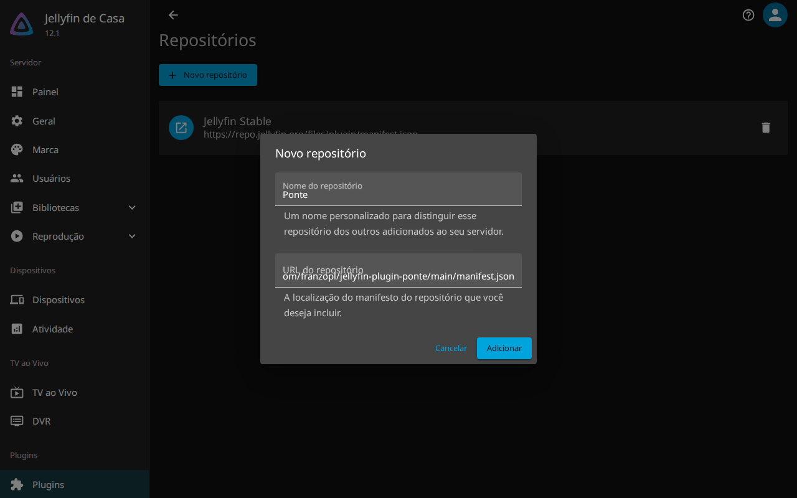

Clique em **Adicionar**. O repositório aparece na lista, ao lado do oficial (Jellyfin Stable):

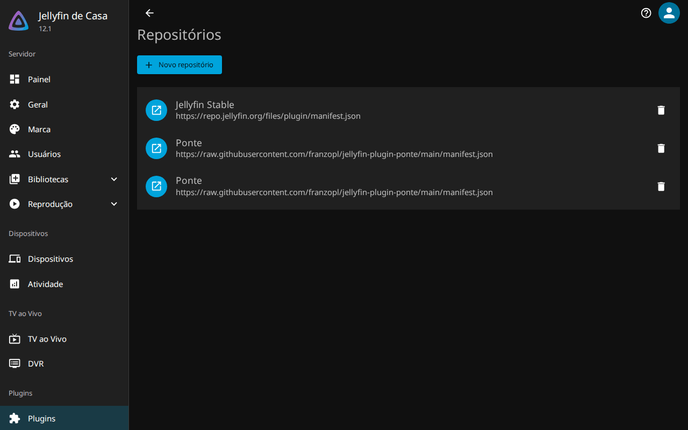

> **Jellyfin 10.11:** o caminho é **Painel → Plugins → Catálogo → ⚙ (engrenagem)**. O resto é igual.

---

## Passo 2: instalar o plugin e reiniciar

Volte para **Painel → Plugins**, escolha o filtro **Disponível** e procure por **Ponte**:

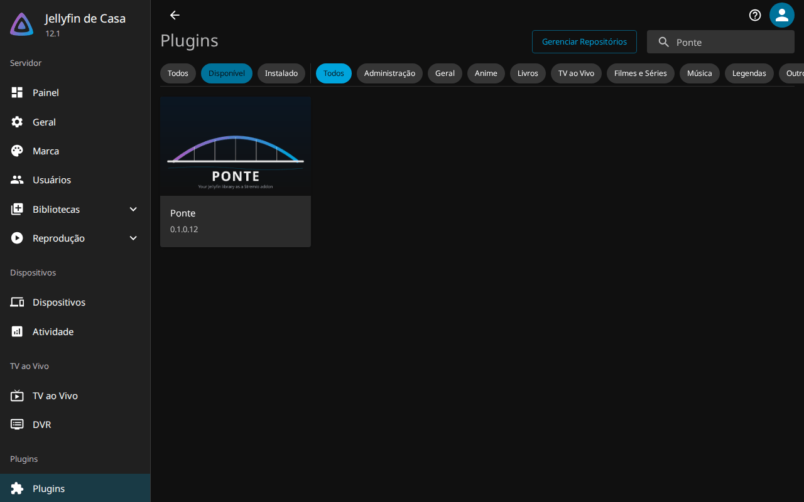

Clique no cartão para abrir a página do plugin. Ela já avisa que o Jellyfin precisa ser reiniciado depois da instalação. Clique em **Instalar**:

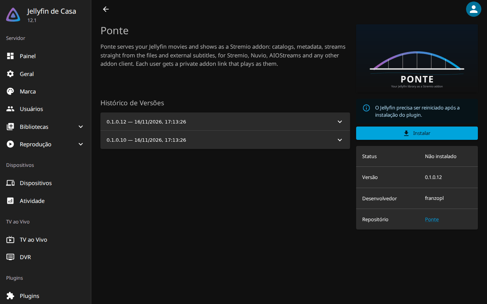

O Jellyfin mostra o aviso padrão sobre plugins de terceiros. O código do Ponte é aberto e está no GitHub; confirme em **Instalar**:

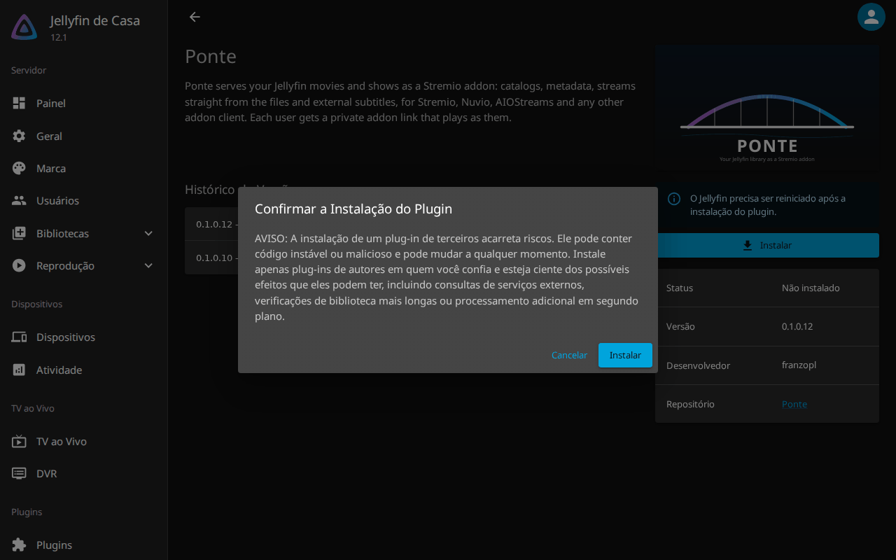

Pronto, o plugin está baixado e o status fica como **Restart** (aguardando reinício):

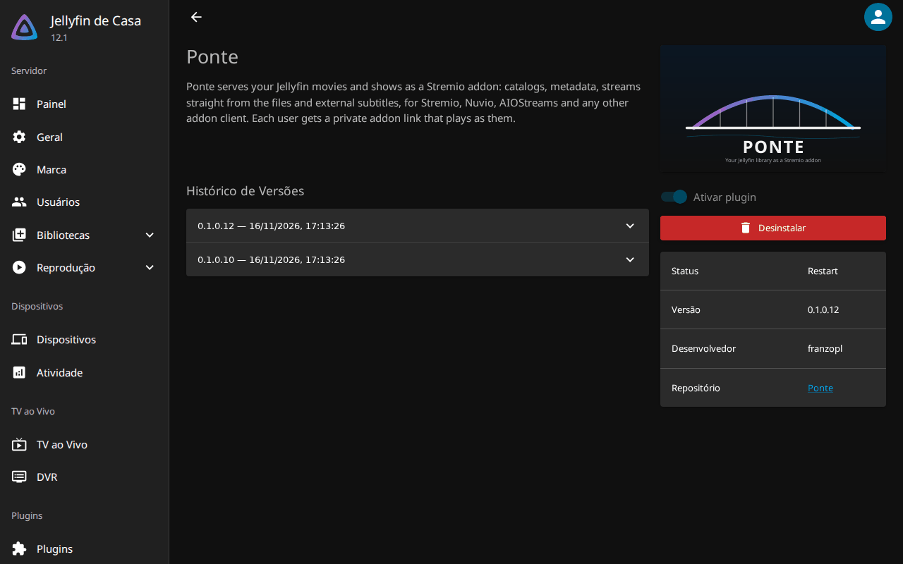

Agora reinicie o servidor em **Painel → Reiniciar**:

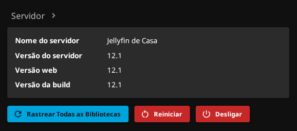

> Se o seu Jellyfin roda em Docker e o botão não volta o servidor sozinho, reinicie o container (`docker restart jellyfin`).

Depois do reinício, o Ponte aparece em **Plugins → Instalado** como **Active**.

---

## Passo 3: pegar o seu link de addon

### Se você é o administrador

Abra **Painel → Plugins → Ponte**. No topo está o **seu** link (Manifest URL), com três botões:

- **Copy**: copia o link;
- **Open in Stremio**: abre o Stremio já na tela de instalar o addon;
- **Reset link**: gera um link novo e desliga o antigo.

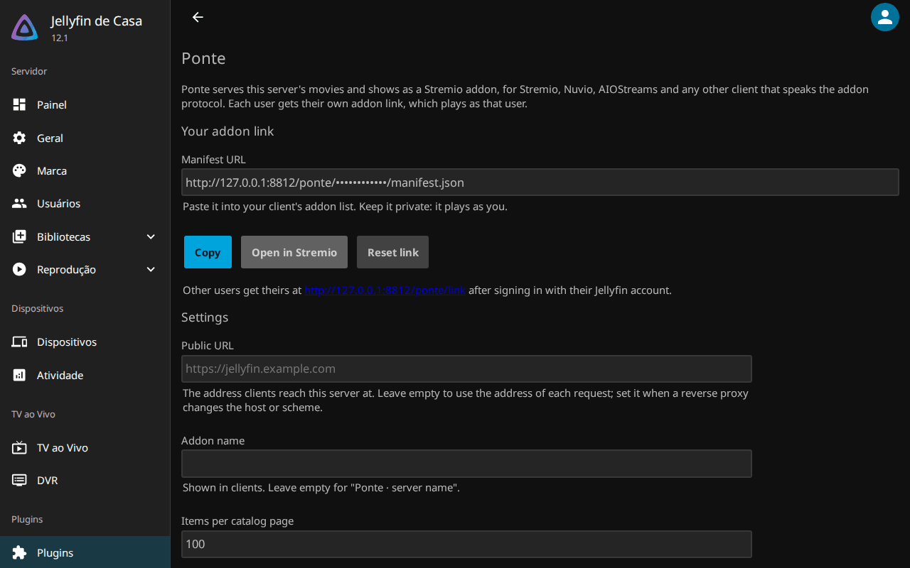

### Para os outros usuários do seu Jellyfin

Cada usuário tem **o próprio link**, que toca **como ele**: respeita as bibliotecas que ele pode ver e o controle parental dele. Mande para a família ou amigos o endereço:

```
https://SEU-JELLYFIN/ponte/link
```

Eles entram com o usuário e a senha do Jellyfin:

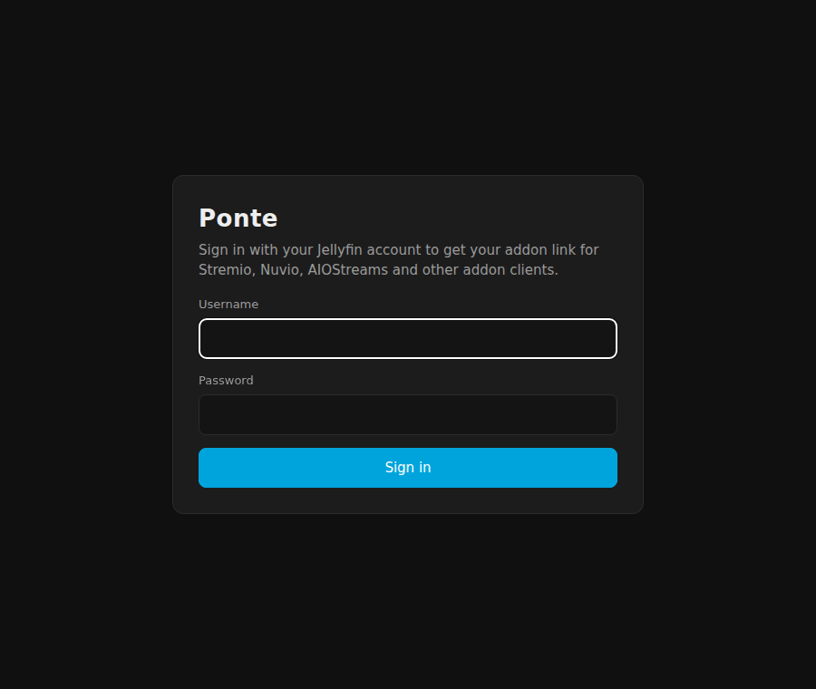

E recebem o link deles, com os mesmos botões de copiar, abrir no Stremio e resetar:

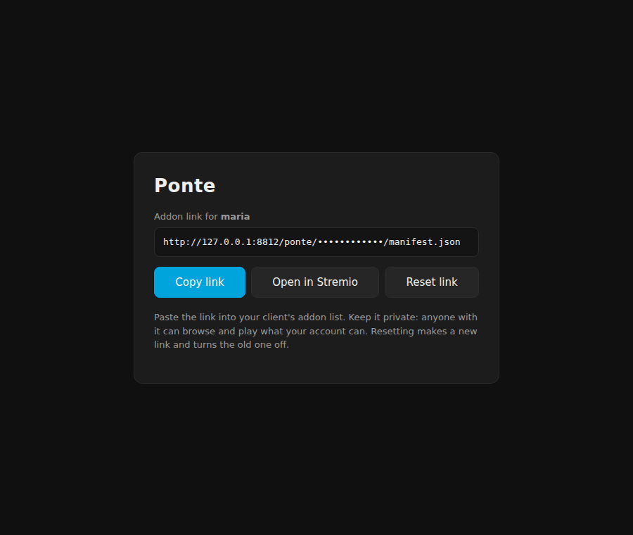

> ⚠️ **Trate o link como uma senha.** Ele tem o formato `https://SEU-JELLYFIN/ponte/<segredo>/manifest.json`, e quem tiver esse endereço consegue navegar e tocar tudo o que a sua conta vê. Nas imagens deste guia o segredo está mascarado (`••••`). Vazou? Clique em **Reset link** e adicione o link novo no seu cliente.

---

## Passo 4: adicionar no seu cliente

### Stremio

O jeito mais fácil é o botão **Open in Stremio**. Outra opção: no Stremio, vá em **Addons**, cole o link na busca e confirme. O Stremio mostra o nome do addon (por padrão, `Ponte · nome do seu servidor`) e os tipos suportados. Clique em **Install**:

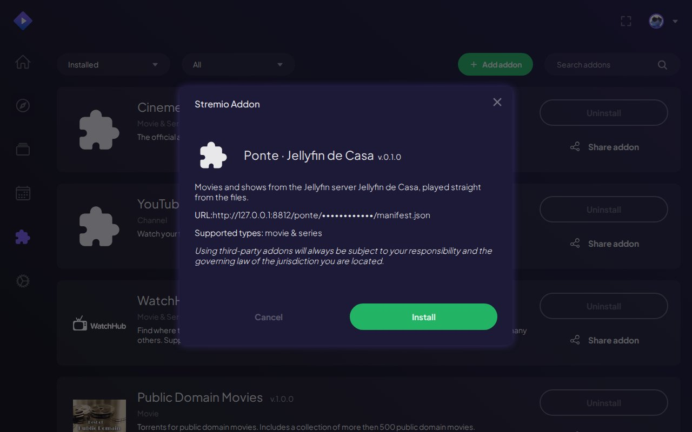

Em **Descobrir**, escolha o catálogo da sua biblioteca. Capas, sinopses e gêneros vêm do próprio Jellyfin, então aparecem no idioma que você configurou lá:

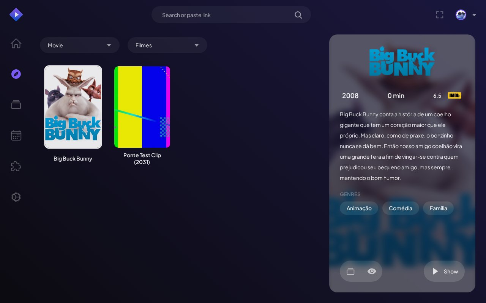

E na página de qualquer filme ou série que você tenha, os seus arquivos aparecem como streams. Cada versão vira um stream separado, da maior resolução para a menor, com codec, HDR/DV, áudio, idiomas e tamanho:

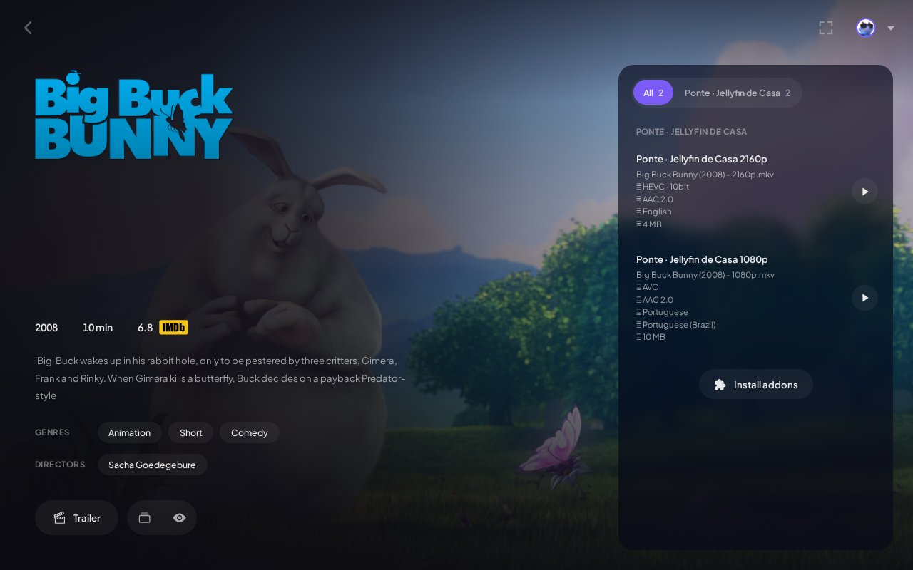

O Ponte cria estes catálogos (cada um pode ser desligado nos ajustes):

- **um por biblioteca** de filmes e de séries, com busca;
- **Recently added** (adicionados recentemente);
- **Continue watching** (continuar assistindo).

### Nuvio e Omni

Cole o link na busca de addons do app (ou use **Open in Stremio**, se o app abrir esse tipo de link). Funciona igual ao Stremio.

### AIOStreams

Se você já usa o AIOStreams com addons de Usenet ou torrent, dá para juntar os seus arquivos locais aos resultados da Usenet:

1. Na configuração do AIOStreams, adicione um addon **Custom**.
2. Cole o link do Ponte como **manifest URL**.
3. Ative a opção **Library addon**.

Com **Library addon** ligado, o AIOStreams reconhece os streams do Ponte como resultado da sua biblioteca ("Your Media") e consegue colocá-los **antes** dos resultados da Usenet. Os filtros e variantes do AIOStreams (por exemplo, um perfil só 1080p para uma TV mais simples) valem para os streams do Ponte como para qualquer outro addon.

---

## Dentro de casa x fora de casa (leia antes de reclamar que não toca 😄)

O Ponte entrega o arquivo **direto do disco**, com suporte a avançar e voltar. O endereço que o cliente usa para tocar é o mesmo pelo qual ele chegou ao Jellyfin.

- **Tudo na mesma rede (recomendado):** use o endereço local do Jellyfin (ex.: `http://192.168.0.10:8096`) e deixe **Public URL** vazio. A reprodução fica dentro de casa, sem passar por proxy, CDN ou pela internet.
- **Assistir fora de casa:** você precisa de um endereço público com HTTPS (proxy reverso, Cloudflare Tunnel, Tailscale Funnel e afins). Preencha **Public URL** se o proxy mudar o endereço ou o esquema (`http` → `https`), e pegue o link de novo depois de salvar.

> **Stremio no navegador (web.stremio.com):** o navegador bloqueia um site público acessando um endereço da sua rede local, então um Jellyfin em `http://192.168…` não carrega por lá. Use o **app** do Stremio ou um endereço HTTPS público.

---

## Ajustes do plugin

Em **Painel → Plugins → Ponte**, mais abaixo:

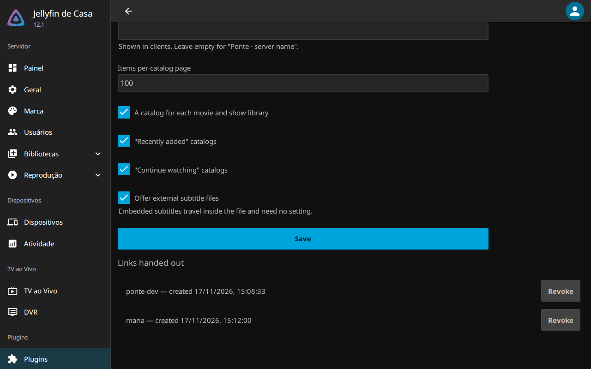

| Ajuste | Padrão | Para que serve |
|---|---|---|
| **Public URL** | vazio | Endereço pelo qual os clientes chegam ao Jellyfin. Vazio usa o endereço de cada requisição. Preencha quando um proxy reverso muda o host ou o esquema. |
| **Addon name** | `Ponte · <servidor>` | Nome que aparece no cliente. |
| **Items per catalog page** | 100 | Itens por página de catálogo. |
| **A catalog for each movie and show library** | ligado | Um catálogo por biblioteca. |
| **"Recently added" catalogs** | ligado | Catálogo de adicionados recentemente. |
| **"Continue watching" catalogs** | ligado | Catálogo de continuar assistindo. |
| **Offer external subtitle files** | ligado | Oferece as legendas externas (`.srt` etc.) que estão ao lado do arquivo. As legendas embutidas já vão dentro do arquivo e não precisam de ajuste. |

Clique em **Save** depois de mudar.

Em **Links handed out** o administrador vê todos os links já entregues (de quem e quando) e pode **revogar** qualquer um com **Revoke**. O link revogado para de funcionar na hora.

---

## Problemas comuns

**O filme aparece no catálogo do Ponte, mas não na página do título no Stremio.**
O Stremio liga as coisas pelo ID do IMDb ou do TMDB. Confira se o item está identificado no Jellyfin (**Editar metadados → Identificar**). Nomear a pasta com o ID ajuda muito, por exemplo `Big Buck Bunny (2008) [imdbid-tt1254207]`. Itens sem IMDb/TMDB continuam funcionando, mas só pelos catálogos do Ponte.

**Toca no Jellyfin, mas não no cliente.**
O Ponte entrega o arquivo como ele é, sem transcodificar. Se a TV ou o app não decodifica o formato (Dolby Vision em algumas TVs, por exemplo), o problema é do lado do cliente. No AIOStreams, filtre esses formatos (ex.: excluir DV para aquela TV). Transcodificação pelo Jellyfin está nos planos do plugin.

**O cliente não consegue nem carregar o addon.**
Abra o link no navegador do mesmo aparelho: deve aparecer um texto em JSON. Se não abrir, o problema é de rede ou de endereço (veja *Dentro de casa x fora de casa*). Se você mudou o **Public URL**, pegue o link de novo.

**Resetei o link e o cliente parou.**
É o esperado: o link antigo deixa de funcionar. Remova o addon antigo do cliente e adicione o link novo.

**Os itens do Gelato não aparecem.**
De propósito. O Ponte só serve itens com arquivo local de verdade; itens virtuais, `.strm` e os do Gelato ficam de fora, para o AIOStreams não receber de volta os próprios streams.

**Assisti pelo Stremio e o Jellyfin não marcou como visto.**
Ainda não há retorno de progresso para o Jellyfin; está no roteiro do plugin.

---

## Links

- Código e versões: https://github.com/franzopl/jellyfin-plugin-ponte
- [English version of this guide](guide.md)
- Repositório para o Jellyfin: `https://raw.githubusercontent.com/franzopl/jellyfin-plugin-ponte/main/manifest.json`

*Guia testado com o Ponte 0.1.0 num Jellyfin 12.1 limpo (instalação pelo repositório) e no Stremio Web. Encontrou um problema? Abra uma [issue](https://github.com/franzopl/jellyfin-plugin-ponte/issues).*
