# Guide: Ponte, your Jellyfin library in Stremio, Nuvio and AIOStreams

[🇧🇷 Português](guia.pt-BR.md) · 🇺🇸 English

**Ponte** is a Jellyfin plugin that turns your library into a **Stremio addon**. Once it is installed, any client that speaks the addon protocol (Stremio, Nuvio, Omni, AIOStreams and others) can browse and play the movies and shows on your server, straight from the files.

It is the reverse of Gelato (which brings Stremio addons into Jellyfin). The two get along: Ponte never serves the items Gelato creates.

In this guide you will:

1. add Ponte's repository to Jellyfin;
2. install the plugin and restart the server;
3. get your addon link (and learn how per-user links work);
4. add the link to Stremio, Nuvio, Omni or AIOStreams;
5. tune the settings and fix the most common problems.

It takes about 10 minutes.

---

## What you need

- **Jellyfin 10.11 or 12.x** with administrator access. The catalog picks the right package for your version.
- **Movies and shows identified in Jellyfin** (IMDb or TMDB). That is what makes your file show up on the title's page in Stremio. If your library already shows the right posters and overviews, you are set.
- **An addon client**: the Stremio app, Nuvio, Omni or an AIOStreams instance.

---

## Step 1: add the repository

In Jellyfin, open **Dashboard → Plugins → Manage Repositories** and click **New Repository**.

- **Repository name:** `Ponte`
- **Repository URL:**

```
https://raw.githubusercontent.com/franzopl/jellyfin-plugin-ponte/main/manifest.json
```

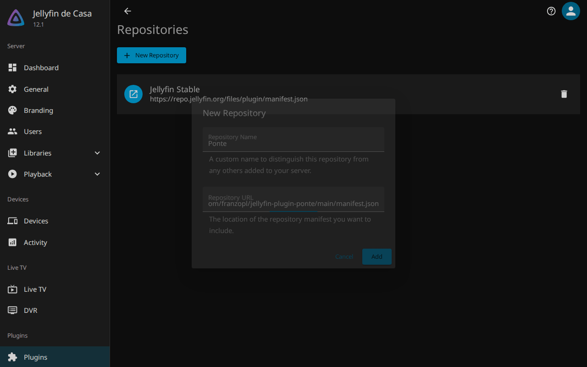

Click **Add**. The repository shows up in the list next to the official one (Jellyfin Stable):

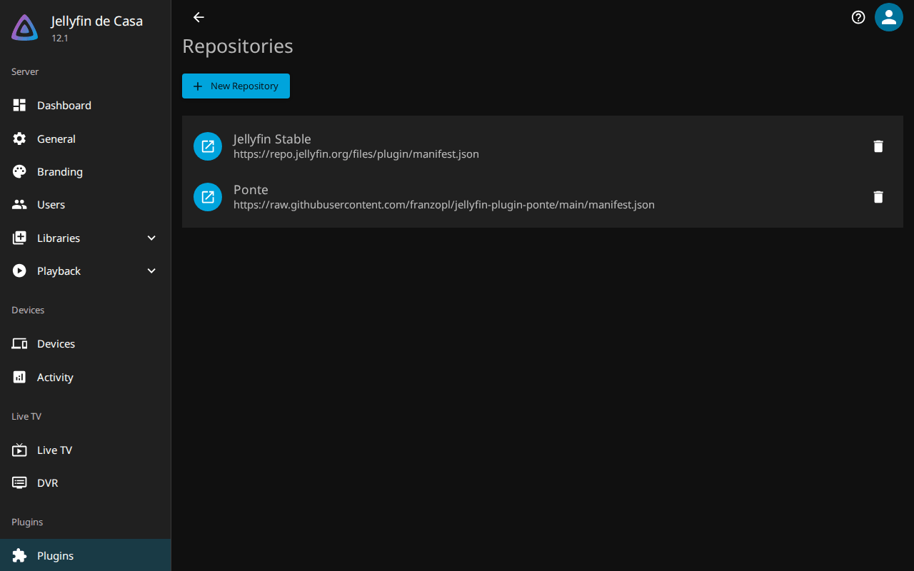

> **Jellyfin 10.11:** the path is **Dashboard → Plugins → Catalog → ⚙ (gear)**. Everything else is the same.

---

## Step 2: install the plugin and restart

Go back to **Dashboard → Plugins**, pick the **Available** filter and search for **Ponte**:

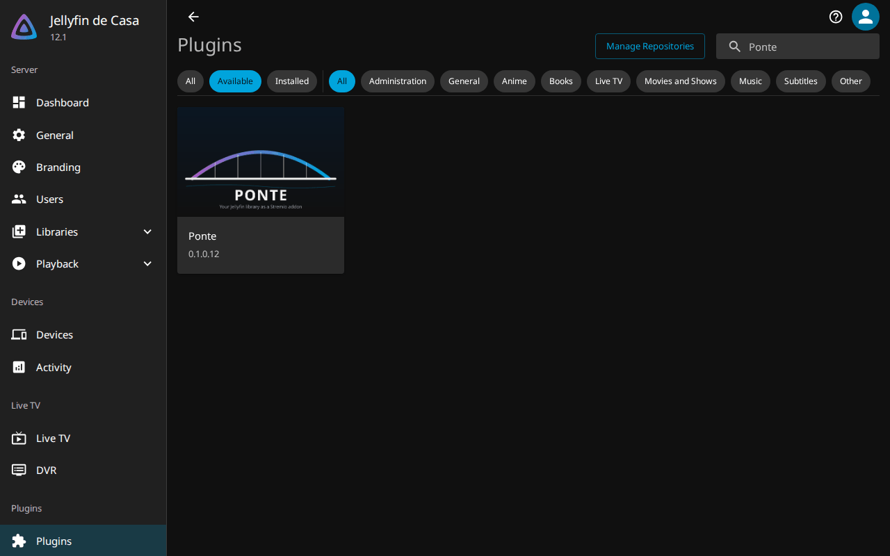

Click the card to open the plugin page. It already tells you Jellyfin needs a restart after installing. Click **Install**:

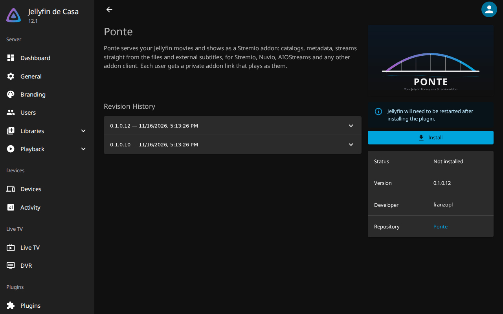

Jellyfin shows its standard warning about third-party plugins. Ponte's code is open and on GitHub; confirm with **Install**:

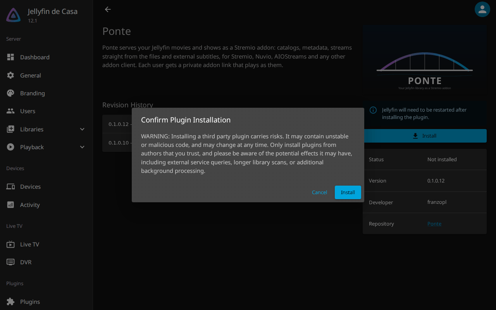

Done: the plugin is downloaded and its status reads **Restart** (waiting for a restart):

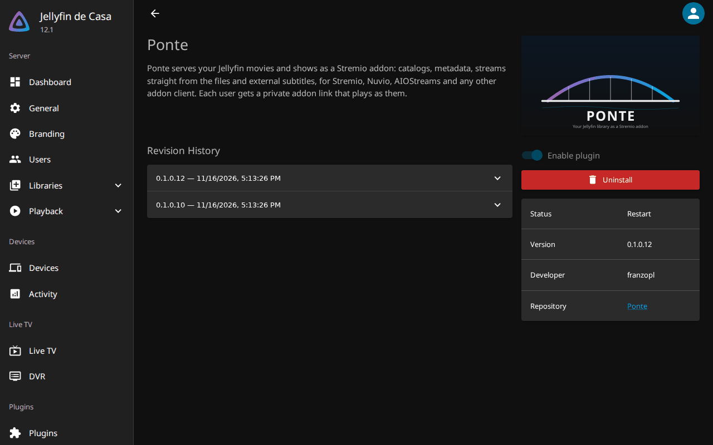

Now restart the server from **Dashboard → Restart**:

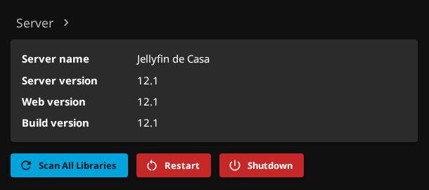

> If your Jellyfin runs in Docker and the button does not bring the server back on its own, restart the container (`docker restart jellyfin`).

After the restart, Ponte shows up under **Plugins → Installed** as **Active**.

---

## Step 3: get your addon link

### If you are the administrator

Open **Dashboard → Plugins → Ponte**. At the top is **your** link (Manifest URL) with three buttons:

- **Copy** copies the link;
- **Open in Stremio** opens Stremio right on the addon install screen;
- **Reset link** makes a new link and turns the old one off.

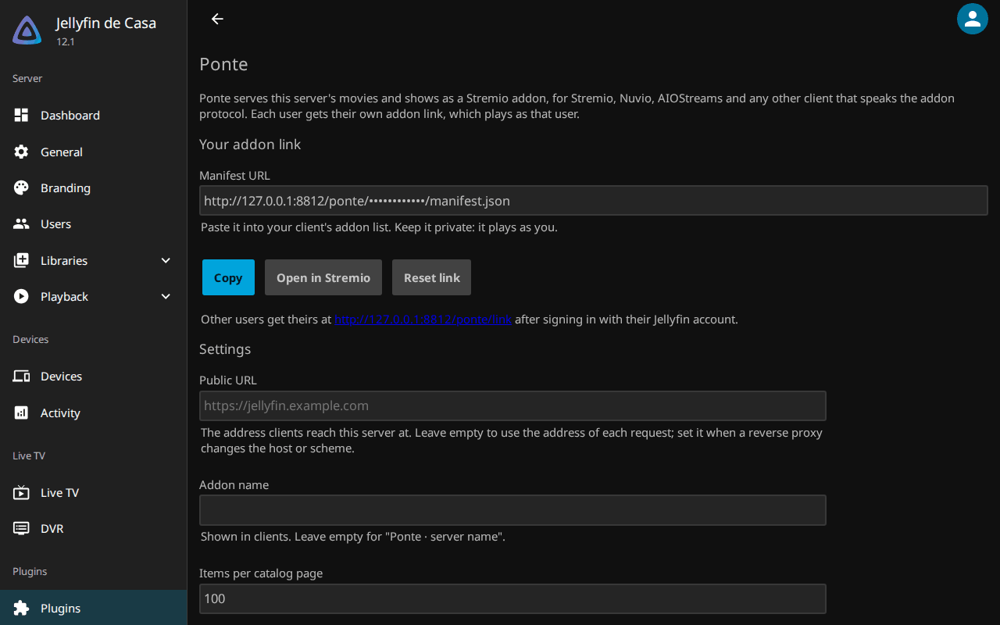

### For the other users of your Jellyfin

Every user has **their own link**, which plays **as them**: it respects the libraries they can see and their parental controls. Send family and friends this address:

```
https://YOUR-JELLYFIN/ponte/link
```

They sign in with their Jellyfin username and password:

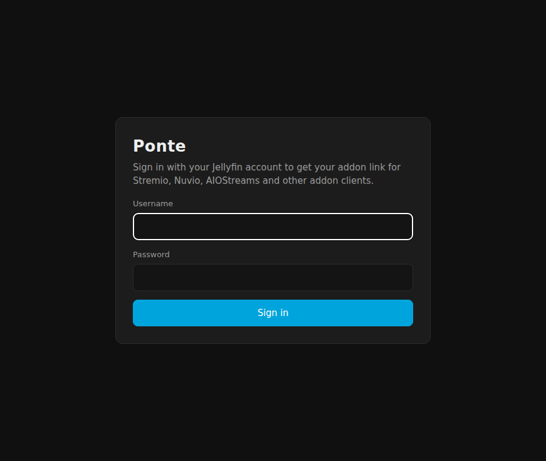

And get their link, with the same copy, open-in-Stremio and reset buttons:

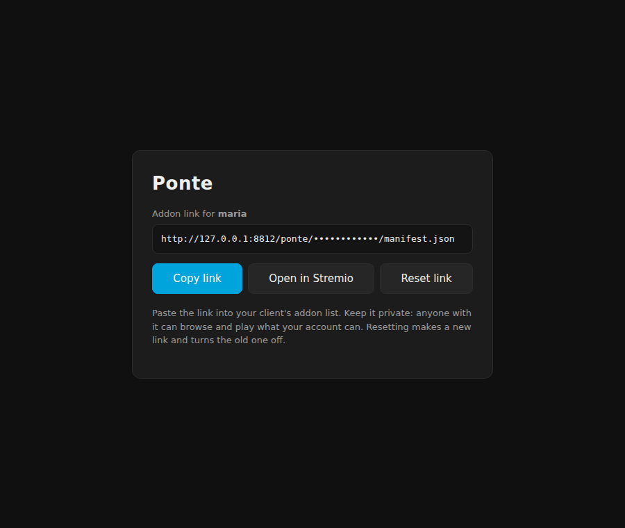

> ⚠️ **Treat the link like a password.** It looks like `https://YOUR-JELLYFIN/ponte/<secret>/manifest.json`, and anyone who has it can browse and play everything your account can. The secret is masked (`••••`) in the pictures of this guide. Leaked it? Click **Reset link** and add the new link to your client.

---

## Step 4: add it to your client

### Stremio

The easiest way is the **Open in Stremio** button. Alternatively, in Stremio go to **Addons**, paste the link into the search box and confirm. Stremio shows the addon's name (by default `Ponte · your server's name`) and the supported types. Click **Install**:

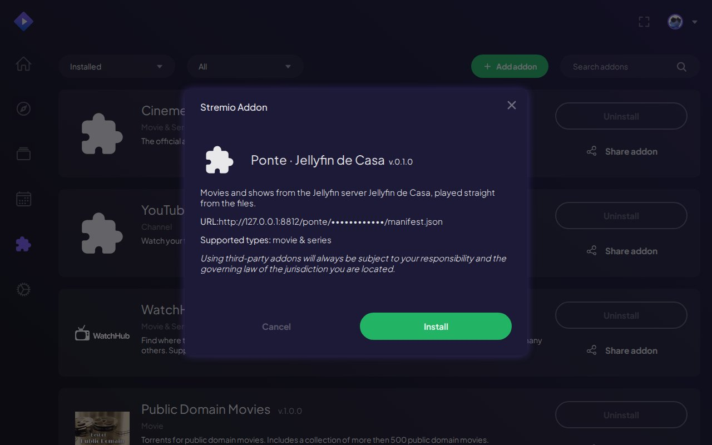

In **Discover**, pick your library's catalog. Posters, overviews and genres come from Jellyfin itself, so they show up in whatever language you set there (Portuguese in these pictures):

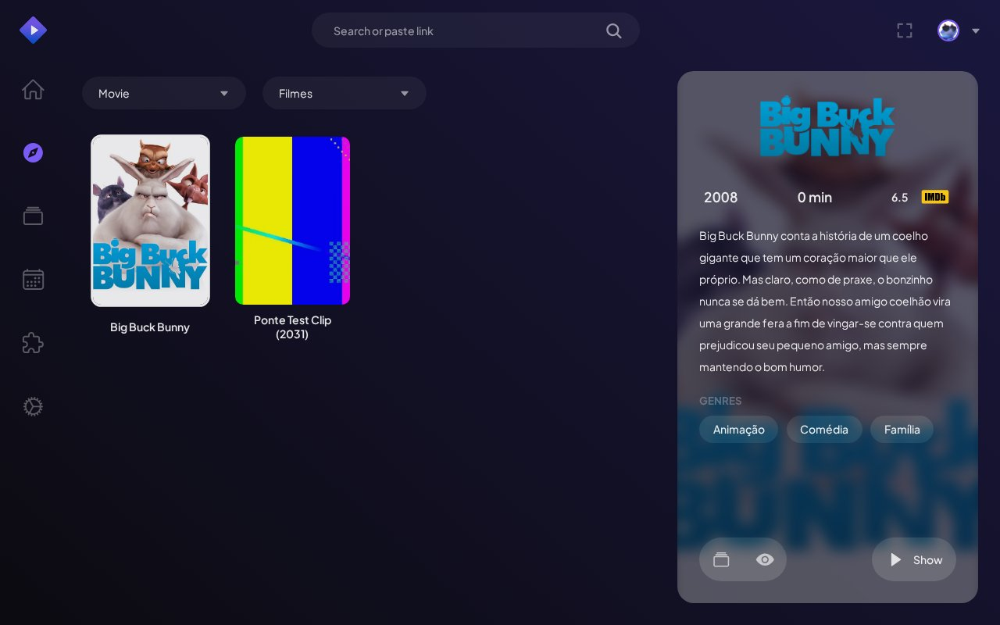

And on the page of any movie or show you own, your files show up as streams. Each version becomes its own stream, highest resolution first, with codec, HDR/DV, audio, languages and size:

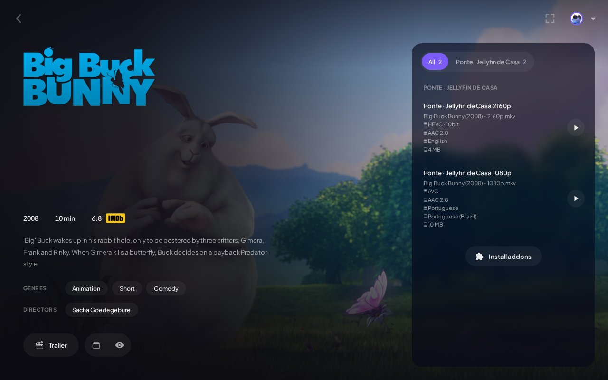

Ponte provides these catalogs (each can be turned off in the settings):

- **one per** movie and show **library**, with search;
- **Recently added**;
- **Continue watching**.

### Nuvio and Omni

Paste the link into the app's addon search (or use **Open in Stremio** if the app handles that kind of link). It works just like Stremio.

### AIOStreams

If you already use AIOStreams with Usenet or torrent addons, you can merge your local files into those results:

1. In AIOStreams' configuration, add a **Custom** addon.
2. Paste Ponte's link as the **manifest URL**.
3. Turn on **Library addon**.

With **Library addon** on, AIOStreams recognises Ponte's streams as results from your own library ("Your Media") and can sort them **ahead** of everything else. AIOStreams' filters and variants (a 1080p-only profile for a simpler TV, for example) apply to Ponte's streams like to any other addon's.

---

## At home vs. away from home (read this before saying it doesn't play 😄)

Ponte serves the file **straight from disk**, with seeking. The address the client plays from is the one it used to reach Jellyfin.

- **Everything on the same network (recommended):** use Jellyfin's local address (e.g. `http://192.168.0.10:8096`) and leave **Public URL** empty. Playback stays inside your home, without going through a proxy, a CDN or the internet.
- **Watching away from home:** you need a public HTTPS address (reverse proxy, Cloudflare Tunnel, Tailscale Funnel and the like). Fill in **Public URL** if the proxy changes the host or the scheme (`http` → `https`), and get your link again after saving.

> **Stremio in the browser (web.stremio.com):** the browser blocks a public website from reaching an address on your local network, so a Jellyfin at `http://192.168…` does not load there. Use the Stremio **app** or a public HTTPS address.

---

## Plugin settings

Under **Dashboard → Plugins → Ponte**, further down:

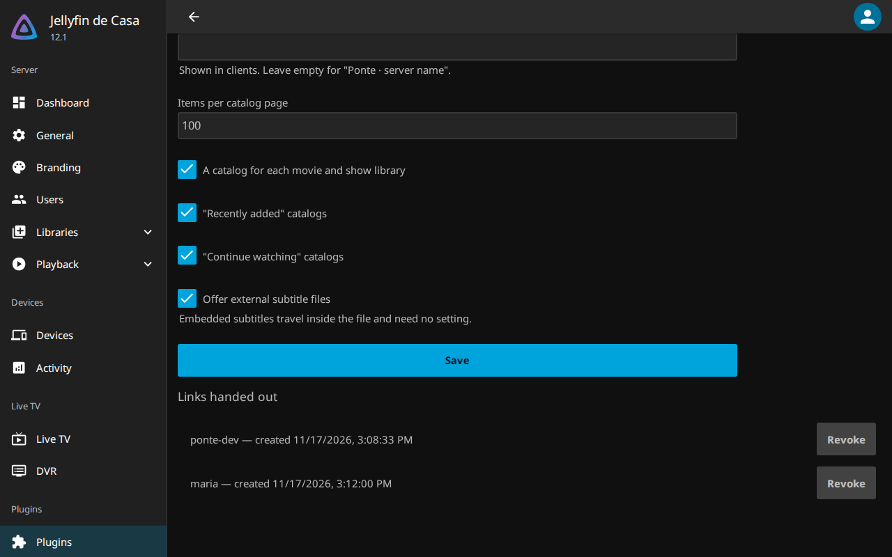

| Setting | Default | What it does |
|---|---|---|
| **Public URL** | empty | The address clients reach Jellyfin at. Empty uses the address of each request. Set it when a reverse proxy changes the host or the scheme. |
| **Addon name** | `Ponte · <server>` | The name clients show. |
| **Items per catalog page** | 100 | Items per catalog page. |
| **A catalog for each movie and show library** | on | One catalog per library. |
| **"Recently added" catalogs** | on | Recently added catalog. |
| **"Continue watching" catalogs** | on | Continue watching catalog. |
| **Offer external subtitle files** | on | Offers the external subtitles (`.srt` and so on) next to the file. Embedded subtitles travel inside the file and need no setting. |

Click **Save** after changing anything.

Under **Links handed out** the administrator sees every link given out (whose and when) and can **revoke** any of them with **Revoke**. A revoked link stops working right away.

---

## Common problems

**The movie shows up in Ponte's catalog but not on the title's page in Stremio.**
Stremio matches things by IMDb or TMDB id. Check that the item is identified in Jellyfin (**Edit metadata → Identify**). Putting the id in the folder name helps a lot, e.g. `Big Buck Bunny (2008) [imdbid-tt1254207]`. Items without IMDb/TMDB still work, but only through Ponte's catalogs.

**It plays in Jellyfin but not in the client.**
Ponte serves the file as it is, without transcoding. If the TV or the app cannot decode the format (Dolby Vision on some TVs, for example), the problem is on the client side. In AIOStreams, filter those formats out (e.g. exclude DV for that TV). Transcoding through Jellyfin is on the plugin's roadmap.

**The client cannot even load the addon.**
Open the link in a browser on the same device: you should see JSON text. If it does not open, it is a network or address problem (see *At home vs. away from home*). If you changed **Public URL**, get your link again.

**I reset the link and the client stopped working.**
That is expected: the old link stops working. Remove the old addon from the client and add the new link.

**Gelato's items don't show up.**
On purpose. Ponte only serves items backed by a real local file; virtual items, `.strm` files and Gelato's items are left out, so AIOStreams never gets its own streams back.

**I watched in Stremio and Jellyfin didn't mark it as watched.**
Playback is not reported back to Jellyfin yet; it is on the plugin's roadmap.

---

## Links

- Code and releases: https://github.com/franzopl/jellyfin-plugin-ponte
- Repository for Jellyfin: `https://raw.githubusercontent.com/franzopl/jellyfin-plugin-ponte/main/manifest.json`
- [Versão em português deste guia](guia.pt-BR.md)

*Guide tested with Ponte 0.1.0 on a clean Jellyfin 12.1 (installed from the repository) and on Stremio Web. Found a problem? Open an [issue](https://github.com/franzopl/jellyfin-plugin-ponte/issues).*
